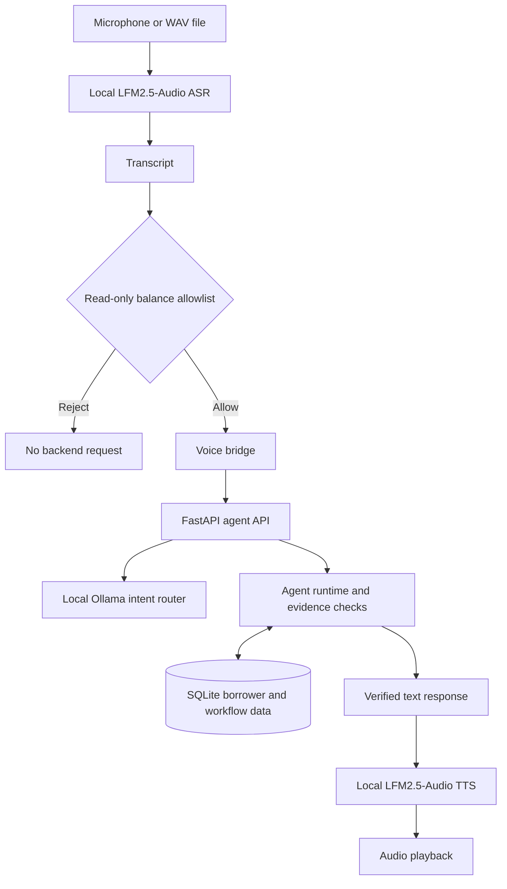

# EchoResolve

EchoResolve is a local voice interface and borrower-workflow prototype for synthetic collections scenarios. It lets a borrower ask a restricted read-only balance question, while a FastAPI backend retrieves persisted account facts and supports separately guarded payment-proposal and confirmation workflows. It uses separate audio transcription (ASR) and speech synthesis (TTS), not a native speech-to-speech model.

## Table of Contents

- [About](#about)
- [Architecture](#architecture)
- [Built With](#built-with)
- [Getting Started](#getting-started)
- [Demo](#demo)
- [Evaluation](#evaluation)
- [Limitations](#limitations)

## About

Implemented behavior:

- Retrieves synthetic borrower/account context from SQLite.
- Creates policy-checked proposals without creating a commitment at proposal time.
- Confirms a persisted proposal by ID; rejects wrong-borrower, expired, or already-processed proposals and prevents duplicate commitments.
- Checks tool results before the agent reports a successful context lookup or confirmation.
- Restricts the voice CLI to a narrow allowlist of read-only balance questions; rejected utterances are not sent to the agent backend.
- Routes ordinary agent intents through a local Ollama model with a clarification fallback when inference fails or returns an unsupported intent.
- Configures pytest to use a separate temporary database via `ECHORESOLVE_DB_PATH` **in the current working tree only if your local `store.py` implements that override**. The currently published `main` version hard-codes `data/echoresolve.db`; do not run database-resetting tests or the evaluator against that database until isolation is confirmed.

## Architecture



The API also exposes context, proposal, proposal-confirmation, commitment, intent-routing, and agent-turn endpoints. Proposals require a separate confirmation step; confirming records a commitment with status `pending_confirmation`. No real payment is executed.

## Built With

- Python 3.11
- FastAPI and Pydantic
- SQLite
- Pytest
- Ollama for text-intent routing (`llama3.2:1b`)
- LFM2.5-Audio behind an OpenAI-compatible API for ASR and TTS

## Getting Started

### Prerequisites

- Python 3.11
- Ollama with `llama3.2:1b` available locally for backend intent routing
- LFM2.5-Audio server reachable at `http://127.0.0.1:9931/v1` for the voice CLI
- Audio input/output devices for microphone recording and playback; WAV input can be used without a microphone

There is no root `requirements.txt`, `pyproject.toml`, or lockfile in the published repository. The audio helper declares `numpy`, `pyaudio`, `soundfile`, `openai`, and `prompt_toolkit` as script dependencies; the API/tests also require FastAPI, Pydantic, Uvicorn, and pytest/httpx-compatible test dependencies. Install the dependencies in a Python 3.11 virtual environment using package versions appropriate for your OS/audio drivers. A reproducible dependency lock has not yet been established.

### Start the backend

From the repository root, in PowerShell:

```powershell
python -m venv .venv
.\.venv\Scripts\Activate.ps1
python -m pip install fastapi pydantic uvicorn pytest httpx openai numpy pyaudio soundfile prompt_toolkit
ollama pull llama3.2:1b
$env:PYTHONPATH = ".\src"
python -m uvicorn echoresolve.api:app --host 127.0.0.1 --port 8000
```

Check that the API responds:

```powershell
Invoke-RestMethod http://127.0.0.1:8000/health
```

### Start the voice CLI

With the API and LFM2.5-Audio server running, open a second PowerShell terminal from the repository root:

```powershell
$env:PYTHONPATH = ".\src"
python .\scripts\echoresolve_voice.py --base-url http://127.0.0.1:9931/v1 --agent-url http://127.0.0.1:8000
```

The CLI imports `scripts/liquid_audio_chat.py`, which uses PyAudio, NumPy, SoundFile, and the OpenAI Python client. Audio-driver setup differs by platform.

## Demo

1. Start Ollama, the LFM2.5-Audio server, and the FastAPI API.
2. Launch the voice CLI.
3. Enter `/record` and ask a simple question such as “What is my outstanding balance?”, or enter `/wav <path>` to use a WAV file.
4. The voice gate rejects requests outside its read-only balance allowlist before calling the backend.
5. The backend retrieves the synthetic borrower context for `BOR-1001`, returns the verified balance, and TTS speaks the response.
6. Enter `/quit` to exit.

The API's read-only context endpoint is `GET /borrowers/BOR-1001/context`; health is `GET /health`. Payment proposal flows are exercised separately through the API/agent workflows and are not invoked by the voice CLI.

## Evaluation

Previously reported results:

| Check | Result |
|---|---:|
| Full automated suite | 71 passed |
| Voice-intent regression cases | 18 passed |
| Named functional scenarios | 11/11 passed |

The 11 named cases cover known/missing borrower context, proposal amount/date checks, no commitment before confirmation, proposal-bound confirmation, expiry, duplicate-confirmation prevention, rejection of unverified tool success, and safe fallback. These counts were reported from the Windows working copy; they have **not been rerun against the current published `main` checkout in this environment**. The currently published version's hard-coded database path makes test/evaluation isolation especially important.

A previous single local voice run observed roughly **5.1 s for transcription**, **6.3 s for speech generation**, and about **4.9 s of generated audio**. This is a one-run observation, not a controlled benchmark or performance guarantee.

## Limitations

- Synthetic data and prototype scope only; no real collections activity or payment execution.
- The voice allowlist is a narrow input filter, not authentication or a security boundary. The API has no authentication and should not be exposed to untrusted networks.
- A root dependency manifest and pinned, reproducible environment are not yet present.
- Production security, privacy/retention controls, observability, load and recovery testing, and collections-specific legal review have not been demonstrated.
