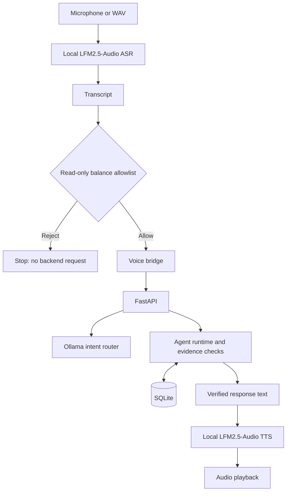

# EchoResolve

EchoResolve is a local voice interface and borrower-workflow prototype for synthetic collections scenarios. It supports read-only balance questions through separate audio transcription (ASR) and speech synthesis (TTS), backed by a FastAPI service that reads borrower facts and exposes guarded proposal/confirmation workflows.

## Contents

- [About](#about)
- [Architecture](#architecture)
- [Stack](#stack)
- [Getting Started](#getting-started)
- [Demo](#demo)
- [Evaluation](#evaluation)
- [Limitations](#limitations)

## About

- **Persisted context:** borrower and account facts come from SQLite, not model-generated answers.
- **Proposal safeguards:** policy-checked proposals are stored as pending; confirmation is tied to a saved proposal ID and rejects unknown/wrong-borrower, expired, or already-processed proposals.
- **Explicit confirmation:** the runtime checks proposal ID, amount, and due date before confirmation. A confirmed proposal records a commitment as `pending_confirmation`; it does not execute a payment.
- **Evidence checks:** deterministic runtime checks reject unsupported tools, unverified context sources, incomplete proposal details, and confirmation results without persistence evidence.
- **Voice restriction:** only narrowly matched read-only balance questions are sent to the backend. Other transcripts are rejected at the voice client.

## Architecture



The voice CLI is restricted to read-only balance questions. Proposal and confirmation behavior is exposed separately through the API/agent workflow; voice does not initiate those actions.

## Stack

- Python 3.11
- FastAPI, Pydantic, Uvicorn
- SQLite
- Ollama with `llama3.2:1b` for intent classification
- LFM2.5-Audio served through an OpenAI-compatible API for ASR and TTS
- Pytest

## Getting Started

### Prerequisites

- Python 3.11
- Ollama with `llama3.2:1b` pulled locally
- A running LFM2.5-Audio server reachable at `http://127.0.0.1:9931/v1`
- Microphone/speaker support for recording and playback; a WAV file can be used instead of a microphone

Create a virtual environment in PowerShell from the repository root:

```powershell
python -m venv .venv
.\.venv\Scripts\Activate.ps1
python -m pip install -r requirements.txt
ollama pull llama3.2:1b
$env:PYTHONPATH = ".\src"
```

The requirements file covers the Python API, tests, and voice client. PyAudio may need OS-specific audio drivers or build support.

### Start the API

```powershell
$env:PYTHONPATH = ".\src"
python -m uvicorn echoresolve.api:app --host 127.0.0.1 --port 8000
```

Check readiness in another terminal:

```powershell
Invoke-RestMethod http://127.0.0.1:8000/health
```

### Start the voice CLI

With the API and audio model server running, use a second terminal:

```powershell
$env:PYTHONPATH = ".\src"
python .\scripts\echoresolve_voice.py --base-url http://127.0.0.1:9931/v1 --agent-url http://127.0.0.1:8000
```

The default synthetic borrower is `BOR-1001`. The context endpoint is `GET /borrowers/BOR-1001/context`.

## Demo

1. Start the local Ollama model, LFM2.5-Audio server, and FastAPI service.
2. Launch the voice CLI and enter `/record`, then ask: “What is my outstanding balance?”
3. Alternatively, enter `/wav <path>` to process a WAV file.
4. The client transcribes audio, checks the transcript against the read-only allowlist, sends allowed questions to the backend, and speaks the verified response.
5. Enter `/quit` to exit.

## Evaluation

| Check | Reported result |
|---|---:|
| Full automated suite | 71 passed |
| Voice-intent regression tests | 18 passed |
| Named functional scenarios | 11/11 passed |

The named scenarios cover borrower context, proposal rules, confirmation, expiry, replay protection, evidence verification, and safe fallback. These counts were observed in the Windows working copy; they have not been rerun against the published `main` checkout here.

A previous single local voice run observed about **5.1 s for transcription**, **6.3 s for speech generation**, and **4.9 s of generated audio**. This is a single-run observation, not a controlled benchmark or guarantee.

## Limitations

- Synthetic borrower records only; no real collections activity or payment execution.
- The voice allowlist is not authentication or a robust security boundary.
- The API has no authentication; do not expose it to untrusted networks.
- The published `main` branch currently hard-codes `data/echoresolve.db`. Tests and `scripts/run_evaluation.py` reset records in their configured database, so do not run them against valuable local data. Confirm database isolation before evaluating.
- No production load/recovery evaluation, comprehensive privacy controls, or collections-specific compliance validation has been demonstrated.
