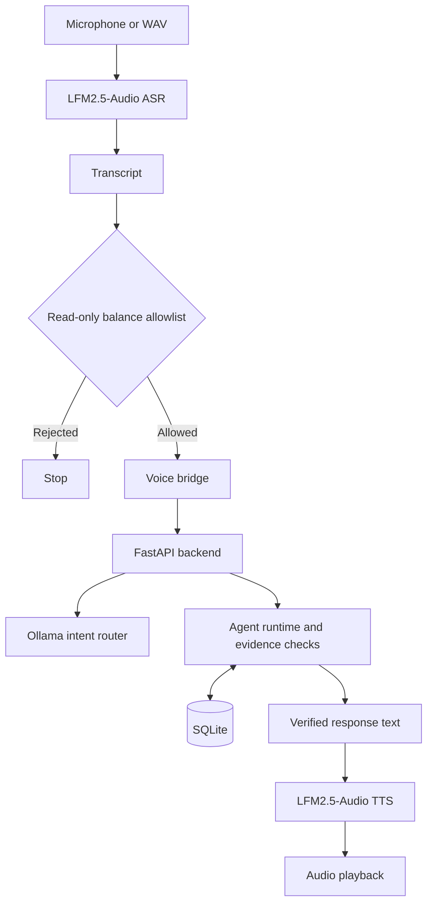

# EchoResolve

EchoResolve is a local voice-enabled collections prototype for synthetic borrower accounts. It uses separate speech recognition (ASR) and speech synthesis (TTS) around a FastAPI backend, retrieving account facts from SQLite and enforcing safeguards around payment proposals and confirmations.

## Contents

- [Features](#features)
- [Architecture](#architecture)
- [Tech Stack](#tech-stack)
- [Setup](#setup)
- [Demo](#demo)
- [Evaluation](#evaluation)
- [Limitations](#limitations)

## Features

- **Verified borrower context** — account facts are retrieved from SQLite.
- **Guarded payment proposals** — creating a proposal does not create a commitment.
- **Explicit confirmation** — checks proposal ID, amount, and due date before confirmation.
- **Expiry and replay protection** — rejects expired or previously processed proposals and prevents duplicate commitments.
- **Response verification** — checks tool results before reporting success.
- **Read-only voice gate** — only narrowly recognized balance questions reach the backend.
- **Test isolation** — test database isolation must be verified in the checkout before running database-resetting tests.

## Architecture



The voice CLI is restricted to read-only balance queries. Payment proposal and confirmation workflows are exposed separately through the API and agent runtime.

## Tech Stack

- Python 3.11
- FastAPI, Pydantic, Uvicorn
- SQLite
- Ollama — `llama3.2:1b` for intent classification
- LFM2.5-Audio — ASR and TTS through an OpenAI-compatible server
- Pytest

## Setup

### Prerequisites

- Python 3.11
- [Ollama](https://ollama.com/) with `llama3.2:1b`
- A running LFM2.5-Audio server at `http://127.0.0.1:9931/v1`
- Audio input/output support for microphone recording and playback; WAV input is an alternative

### Install

Run from the repository root in PowerShell:

```powershell
python -m venv .venv
.\.venv\Scripts\Activate.ps1
python -m pip install -r requirements.txt
ollama pull llama3.2:1b
$env:PYTHONPATH = ".\src"
```

PyAudio may require platform-specific audio drivers or build support.

### Start the API

```powershell
$env:PYTHONPATH = ".\src"
python -m uvicorn echoresolve.api:app --host 127.0.0.1 --port 8000
```

Check that it responds:

```powershell
Invoke-RestMethod http://127.0.0.1:8000/health
```

### Start the voice CLI

With the API and audio model server running, open another terminal:

```powershell
$env:PYTHONPATH = ".\src"
python .\scripts\echoresolve_voice.py --base-url http://127.0.0.1:9931/v1 --agent-url http://127.0.0.1:8000
```

## Demo

1. Start Ollama, the LFM2.5-Audio server, and the FastAPI API.
2. Launch the voice CLI and enter `/record`.
3. Ask: “What is my outstanding balance?”
4. Alternatively, use `/wav <path>` to process an existing WAV file.
5. The transcript passes through the read-only voice gate before reaching the backend. The response is generated from persisted borrower context and spoken through TTS.
6. Enter `/quit` to exit.

The default synthetic borrower is `BOR-1001`. The API context endpoint is `GET /borrowers/BOR-1001/context`.

## Evaluation

| Check | Reported result |
|---|---:|
| Automated test suite | 71 passed |
| Voice-intent regression tests | 18 passed |
| Named functional scenarios | 11/11 passed |

The named scenarios cover borrower context, proposal policy, confirmation, expiry, duplicate-confirmation prevention, response verification, and safe fallback.

**Verification note:** These results were previously reported from the Windows working copy; they have not been rerun against the published `main` checkout here. The published code hard-codes `data/echoresolve.db`, and tests/evaluation can reset records. Verify database isolation before running them against data you need to preserve.

A previous single local run observed approximately **5.1 seconds for transcription**, **6.3 seconds for speech generation**, and **4.9 seconds of generated audio**. These are observations from one run, not benchmark results or guarantees.
- The API has no authentication; do not expose it to untrusted networks.
- Dependency versions are not pinned in a lockfile.
- Production security, load/recovery behavior, privacy controls, and collections-specific compliance have not been demonstrated.
